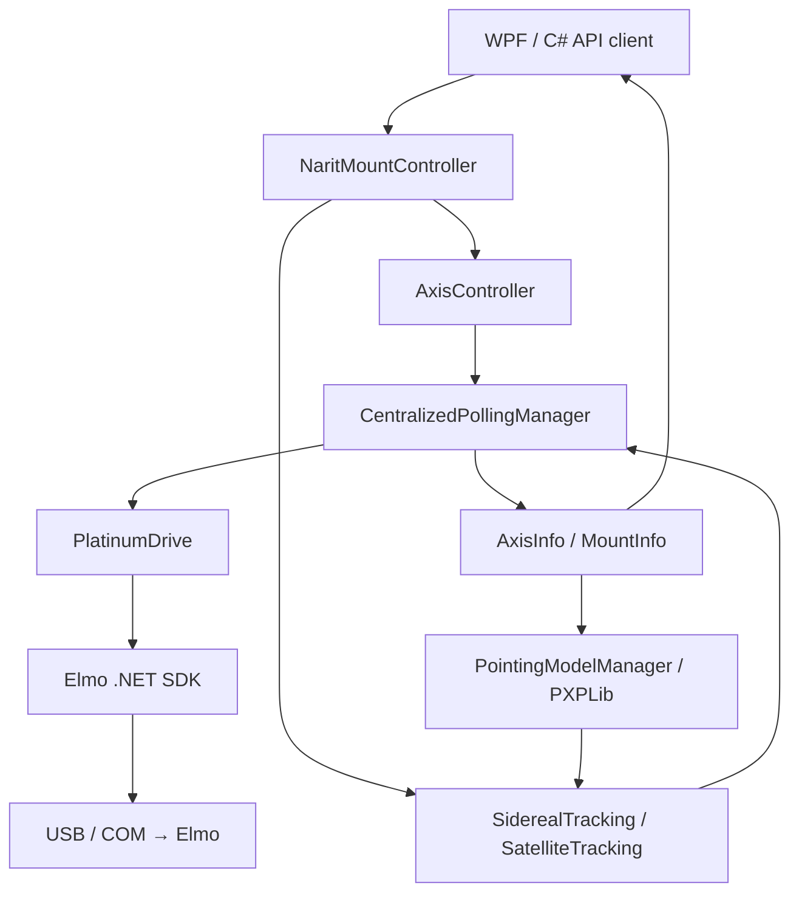
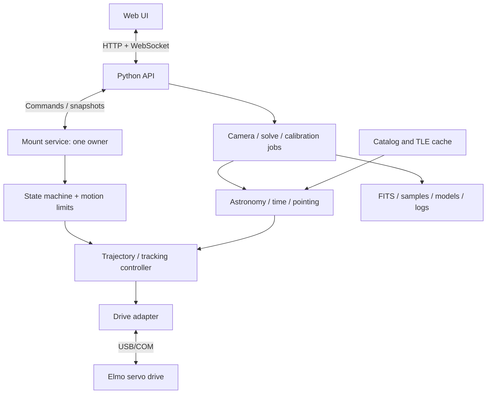

# MountController-API: การศึกษาระบบเดิมและต้นแบบ Python Web App

วันที่ศึกษา: 8 ตุลาคม 2026  
ฐานอ้างอิง: `MountController-API-main`, commit `66b76d0` (9 เมษายน 2026)  
ขอบเขต: อ่าน source, configuration, dependency declarations และเอกสารในเครื่อง; ยังไม่ได้รันโปรแกรม เชื่อมต่อ/สแกนไดรฟ์ หรือทดสอบการเคลื่อนที่  
สถานะ: เอกสารออกแบบสำหรับการเขียนใหม่ ยังไม่มี Python backend หรือ web UI ที่พัฒนาแล้ว

## 1. ข้อสรุปสำหรับการเริ่มเขียนใหม่

ระบบนี้เหมาะกับโครงสร้าง **Web UI → Python API → Mount service บนเครื่องที่ต่อฮาร์ดแวร์ → Elmo drive** โดยให้ service เป็นเจ้าของการควบคุมเพียงตัวเดียว การ polling, tracking และการหยุดต้องทำงานต่อได้โดยไม่พึ่ง browser

ควรนำพฤติกรรม หน่วยพิกัด รูปแบบคำสั่ง และข้อมูล calibration ของระบบเดิมมาเป็นข้อกำหนด แต่แยก engine ออกจาก WPF ก่อนใช้เป็นต้นแบบ ระบบเดิมมีทั้งธุรกิจหลักใน Engine และใน code-behind ของ UI

ส่วนที่ย้ายตรงไป Python ได้ค่อนข้างชัดคือ orchestration, configuration, state, logging, catalogs และ HTTP/WebSocket ส่วนที่ต้องพิสูจน์เพิ่มเติมคือ Elmo transport, ความเทียบเท่าของ PWLib/PXPLib, camera SDK และสมรรถนะ control loop บนเครื่องจริง

## 2. สำเนาโปรเจคและโครงสร้าง

พบสองสำเนา:

| สำเนา | Commit ล่าสุดที่พบ | การใช้ในการศึกษานี้ |
|---|---|---|
| MountController-API-main | 66b76d0, 9 เม.ย. 2026 | ฐานหลัก มี pointing-model และ tracking/catalog updates |
| MountController-API-push-temp | ebe7c95, 2 เม.ย. 2026 | สำเนาเก่ากว่า ไม่ใช้เป็นฐานออกแบบ |

สำเนาหลักไม่มี tracked changes ก่อนเริ่มศึกษา แต่มี ZIP ที่ยังไม่ถูกติดตามอยู่แล้ว เอกสารนี้ไม่ได้ตรวจเนื้อหา ZIP หรือยืนยันว่า ZIP ตรงกับ source

| Project | บทบาท |
|---|---|
| NARIT-Mount-API | Public C# library: Connect, Enable, Goto, Jog, Stop, Tracking, Offset, Status และ Events |
| Narit-Mount-Lib | WPF application และ engine หลัก รวม drive, control, astronomy, camera, calibration |
| NARIT-Mount-API-Tester | WPF client สำหรับทดลอง public API; ไม่ควรนับเป็น automated test suite |
| CCD_FLI / CCD_TEST | โมดูลและแอปทดสอบกล้องเดิม; CCD_FLI มี Nancy HTTP host ของตัวเอง |
| NARIT-Collimation-Manager | แอป WPF แยกสำหรับ workflow collimation |

Public API และ engine หลักใช้ `net10.0-windows`, x64; engine เป็น WPF WinExe ที่ API อ้างอิง จึงยังผูกกับ Windows และ UI runtime คำว่า “API” ของเมาท์ในโปรเจคนี้เป็น API ใน process ไม่ใช่ REST API ที่ browser เรียกได้ทันที ดู [project definition](C:/Users/Narit/Documents/GitHub/MountController-API-main/Narit-Mount-Lib/Narit-Mount-Lib.csproj) และ [public interface](C:/Users/Narit/Documents/GitHub/MountController-API-main/NARIT-Mount-API/Interfaces/IMountController.cs).

เส้นทางหลัก:



[MountRuntimeBootstrap](C:/Users/Narit/Documents/GitHub/MountController-API-main/Narit-Mount-Lib/Engine/Manager/MountRuntimeBootstrap.cs:32) จัด runtime ร่วมให้ API และ WPF แต่ยังใช้ `App.PollingManager` และ `App.PointingModelManager` แบบ global; การสร้าง controller หลาย instance ไม่ได้แปลว่ารองรับหลายเมาท์อย่างแยกขาด

## 3. Elmo: การเชื่อมต่อและคำสั่ง

### 3.1 เส้นทางเชื่อมต่อที่พบจริง

ใน [PlatinumDrive](C:/Users/Narit/Documents/GitHub/MountController-API-main/Narit-Mount-Lib/Engine/Core/PlatinumDrive.cs:112):

1. ใช้ `DriveLocator.GetUSBDevices()` หาอุปกรณ์
2. อ่าน serial number ด้วย `SN[4]` เพื่อจับคู่กับ COM port
3. สร้าง `DriveCommunicationFactory.CreateUSBCommunicationInfo(comPort)`
4. สร้าง `IDriveCommunication` แล้ว `Connect()`
5. ส่งคำสั่งผ่าน `SendCommandAnalyzeError()`; async wrapper ใช้ `Task.Run` ครอบการเรียก SDK

ไม่ได้พบเส้นทางควบคุมเมาท์ด้วย EtherCAT master หรือ CANopen ใน public API ที่อ่าน แม้ solution จะอ้างอิง DLL ของ GMAS และ CAN บางตัว การมี DLL ไม่ใช่หลักฐานว่า runtime ใช้ transport นั้น

[ConnectAsync](C:/Users/Narit/Documents/GitHub/MountController-API-main/NARIT-Mount-API/NaritMountController.cs:169) ลอง serial ที่บันทึกไว้ก่อน และ fallback ไป drive ตัวแรกที่ scan พบ ในระบบใหม่ควรจับคู่ serial/profile/axis อย่างชัดเจน และรายงาน mismatch แทนการเลือกอุปกรณ์ตัวแรกโดยอัตโนมัติ

### 3.2 Axis mapping

| Logical axis | Shared-drive path ที่ API ใช้ | หมายเหตุ |
|---|---|---|
| Azimuth | AX1 | หมุนแนวราบ ต้องเก็บจำนวนรอบ/ช่วง mechanical position |
| Altitude | AX2 | ยกกล้อง |
| Field derotator | AX3 ตาม config | มี polling และการสั่งจาก InstrumentControl |
| M3 | AX4 ตาม config | มี polling และ manual instrument control |

PollingManager มี overload รองรับ altitude drive แยก โดยใช้ AX1 ของ drive อีกตัว แต่ bootstrap/public AxisController ที่อ่านใช้ shared-drive path และ hard-code AX1/AX2 หลายจุด จึงยังไม่ถือว่าทั้ง API รองรับสอง drive อย่างครบถ้วน ชื่อ FORK1/FORK2 ใน constants เก่าไม่ควรใช้แทนบทบาท AX3/AX4 โดยไม่ดู config

### 3.3 ตารางคำสั่งที่ต้องรักษาความหมาย

| คำสั่ง | การใช้ใน source |
|---|---|
| SN[4] | อ่าน serial ของ drive |
| AXn.PX | ตำแหน่งที่โค้ดตีความเป็น encoder counts |
| AXn.VX | ความเร็วที่โค้ดตีความเป็น counts/s |
| AXn.IQ | motor current |
| AXn.MO / AXn.MO=1 / AXn.MO=0 | อ่าน/เปิด/ปิด motor |
| AXn.IP | digital input; polling หลักอ่านของ AX1 |
| AXn.JP=value แล้ว AXn.BG | สั่ง jog velocity ใน position mode; เป็นทางส่งความเร็วหลักของ tracking |
| AXn.PA=value, AXn.SP=value, AXn.BG | Goto ด้วยตำแหน่ง absolute และความเร็ว |
| AXn.ST | คำสั่งหยุดของ drive |
| AXn.CA[18], fallback AXn.CA18 | โค้ดลองอ่าน encoder resolution |
| KP[2], KI[2], KP[3], FF[1], FF[2], AC, DC, SF | ชุด tuning/motion parameters ใน manager/UI |

คำสั่งข้างต้นเป็นสิ่งที่พบจาก source ไม่ใช่การยืนยันผลกับ firmware จริง เอกสาร Elmo ในเครื่องระบุว่า JP เป็น jog velocity ใน position mode และมีผลเมื่อเรียก BG; scaling เปลี่ยนได้ผ่าน FC จึงต้องตรวจ user units, operating mode และ limits ของ drive ก่อนถือว่าเลขที่ส่งคือ counts/s เสมอ ดู [คู่มือ JP ในเครื่อง](<C:/Users/Narit/Desktop/Elmo Application Studio II/Elmo Application Studio II/NetHelp/Documents/pjpnjogvelocityinpositionmode.htm>).

การแปลงหน่วยของ application:

```text
mechanical_deg = counts / counts_per_rev * 360 + zero_offset_deg
counts        = (mechanical_deg - zero_offset_deg) / 360 * counts_per_rev
counts_per_s  = deg_per_s / 360 * counts_per_rev
kp2_ui        = kp2_drive * counts_per_rev / 360
```

Gain ของ PID ภายนอกและ gain ภายใน Elmo เป็นคนละชั้น; ไม่ใช้ค่าเดียวกันหรือแปลงด้วย encoder resolution ที่ hard-code ดู [KP[2] conversion policy](C:/Users/Narit/Documents/GitHub/MountController-API-main/Narit-Mount-Lib/Docs/KP2_VELOCITY_GAIN_CONVERSION_POLICY.md).

### 3.4 Python transport: สิ่งที่รู้และสิ่งที่ยังต้องพิสูจน์

พบตัวอย่าง source ที่ถูก decompile ไว้แล้วใน Elmo Application Studio II ของเครื่องนี้: `USBCom` ส่ง command เป็น bytes ตามด้วย CR (13), อ่าน reply จนพบ semicolon, และมีการจัดการ echo/error; `DriveCommunication` มี lock สำหรับ serialize คำสั่ง สิ่งนี้สนับสนุนความเป็นไปได้ของ Python serial adapter แต่ยังไม่ใช่ protocol contract ที่ทดสอบแล้ว

**ข้อจำกัดของหลักฐาน:** source ตัวอย่างระบุ assembly 2.9.0.13 ขณะที่ DLL ใน repo รายงาน FileVersion 1.0.0.8 จึงไม่ควรคัดลอก framing/default baud จากตัวอย่างไปใช้ทันที อีกทั้ง PlatinumDrive ตั้ง baud ผ่าน reflection บน property ชื่อ `BaudRate` แบบ best effort ค่าที่ระบุ 921600 ใน JSON จึงยังไม่ยืนยัน effective transport setting

มีสองทางสำหรับต้นแบบ:

- **รักษา SDK ช่วงแรก:** ทำ adapter/service บน Windows ให้ Python เรียก Elmo/PXPLib เดิม; pythonnet รองรับการโหลด CLR แต่ต้องทดลอง runtime, native dependencies และ thread/STA ของ DLL ชุดนี้แยกต่างหาก ไม่รับประกันว่าโหลด WPF API ทั้งก้อนแล้วใช้แบบ headless ได้ทันที ([Python.NET](https://pythonnet.github.io/pythonnet/python.html)).
- **เขียน serial adapter ใน Python:** ใช้ pySerial หลังยืนยัน request/reply framing, echo, errors, partial reads, timeout recovery, identity และ scaling กับรุ่นจริง ([pySerial API](https://pyserial.readthedocs.io/en/latest/pyserial_api.html)).

เสนอให้ทั้งสองทางใช้ interface เดียวกัน เช่น `DriveTransport` เพื่อให้ simulator, SDK adapter และ serial adapter สลับได้โดยไม่เปลี่ยน control logic

## 4. Configuration ที่ต้องใช้เป็นฐาน

ค่าที่บันทึกใช้งานในเครื่องอยู่ที่ [AppSetting.Fork-Mount.json](C:/Users/Narit/AppData/Local/NARIT/MountController/AppSetting.Fork-Mount.json) และ bootstrap อยู่ที่ [AppSetting.json](C:/Users/Narit/AppData/Local/NARIT/MountController/AppSetting.json); profile ที่พบแก้ไขล่าสุด 21 กันยายน 2026 สิ่งนี้เป็น saved configuration ไม่ใช่ค่าที่อ่านสดจาก hardware

| ค่า | JSON ใน repo | Saved Fork-Mount profile ในเครื่อง |
|---|---|---|
| Azimuth range | −300 ถึง +300° | 45 ถึง 700° |
| Altitude range | 0 ถึง 90° | 0 ถึง 90° |
| Az/Alt encoder resolution | 4,294,967,296 | 4,294,967,296 |
| Observer latitude | 18.852638° | 18.853823° |
| Observer longitude | 98.958352° | 98.958353° |
| Elevation | 350 m | 350 m |
| Azimuth configured baud | 921600 | 921600 |
| M3 encoder resolution | ไม่อยู่ใน seed JSON ที่อ่าน | 262,144 |
| Derotator encoder resolution | ไม่อยู่ใน seed JSON ที่อ่าน | 4,294,967,296 |

เอกสาร CLAUDE.md ระบุพิกัดหอดูดาวอีกชุดหนึ่ง จึงใช้ข้อความในเอกสารนั้นเป็นสถานที่ปัจจุบันไม่ได้

[AppSettings](C:/Users/Narit/Documents/GitHub/MountController-API-main/Narit-Mount-Lib/Engine/Utility/AppSettings.cs:14) เลือก profile ตาม serial และย้าย legacy settings ได้; config model ยังมี drive profile 27-bit (134,217,728 counts/rev) สำหรับ L-Mount ด้วย การออกแบบ Python ต้องผูก profile, encoder scaling, zero offset และ pointing model กับเมาท์ที่ถูกต้อง

**ห้าม normalize mechanical azimuth ทุกค่าเป็น 0–360°:** sky azimuth กับตำแหน่งกลไกแบบหลายรอบต้องเป็นคนละ field มิฉะนั้นตรวจ limits และเลือกเส้นทางหมุนผิด แม้ตำแหน่งบนท้องฟ้าดูเท่ากัน

## 5. Polling และ control loop

[CentralizedPollingManager](C:/Users/Narit/Documents/GitHub/MountController-API-main/Narit-Mount-Lib/Engine/Manager/CentralizedPollingManager.cs:425) ทำงานโดย delay 15 ms แล้วอ่านคำสั่งหลักแบบ sequential: Az PX/VX/IQ/MO/IP และ Alt PX/VX/IQ/MO จากนั้นอัปเดต state, ตรวจ limits, ส่ง command velocities และใช้เวลาที่เหลือสำหรับ extra commands มี AX3/AX4 เพิ่มทุก 5 รอบ

| ส่วน | Interval ที่กำหนดในโค้ด | ความหมาย |
|---|---|---|
| Hardware polling | delay 15 ms + เวลา I/O/ประมวลผล | ไม่ใช่หลักฐานว่าอ่าน hardware ได้ 66.7 Hz จริง |
| Sidereal / Satellite controller | timer 15 ms | คำนวณ command; ความสดของ feedback ขึ้นกับ polling |
| MountManager | timer 5 ms | คำนวณสถานะจากข้อมูลที่มี ไม่ได้อ่าน encoder ใหม่ 200 Hz |
| RMS manager | DispatcherTimer 50 ms | ผูกกับ WPF dispatcher |
| AzimuthPositionControl | timer 20 ms | อีกเส้นทาง control ในโปรแกรมเดิม |

แนวคิด tracking เดิมใช้ outer-loop PID/PD + feedforward และ optional Kalman filtering; Elmo รับผิดชอบ servo loop ภายใน Sidereal controller คำนวณความเร็ว Alt/Az จากตำแหน่งท้องฟ้าต่างเวลากัน 0.1 s ไม่ใช่ส่ง sidereal rate คงที่ให้ทั้งสองแกน

Python ควรใช้ monotonic clock สำหรับ dt/deadline และใช้ UTC/astronomical time สำหรับ ephemeris แยกกัน วัด cycle duration, telemetry age, command latency และ jitter จริงก่อนเลือกความถี่ ไม่ตั้งชื่อ timer แล้วถือว่าได้ real-time guarantee

## 6. งานดาราศาสตร์และพิกัด

| งานเดิม | การทำงานที่พบ | แนวทางย้าย |
|---|---|---|
| Stars / fixed RA-Dec | PWLib RaDec; J2000ToNow เมื่อ target ไม่ได้เป็น apparent; แปลง Alt/Az ตามเวลาและ site | Astropy พร้อม explicit frame, equinox, obstime, proper motion |
| Sidereal lock | แปลงตำแหน่งปัจจุบันเป็น celestial target แล้วติดตาม | แยก hold-sky-position จาก hold-mechanical-position |
| Satellites | PWLib.Astro.Satellite, TLE, topocentric position, PID/VFF, prediction และ azimuth wrap/limit logic | Skyfield หรือ sgp4 + Astropy; เทียบตัวเลขก่อนเปลี่ยน controller |
| Sun / Moon / planets | PWLib.Astro.Planets ใน PlanetTrackingControl; อัปเดตข้อมูลทุก 1 s | ย้ายออกจาก UI ไป ephemeris provider |
| Asteroids / comets / NEOs | SmallBodyEphemerisCalculator และ refresh RA/Dec ทุก 1 s | ใช้เป็น workflow reference; ต้องปรับความแม่นยำและ frame contract |
| Bright stars | JSON 9,096 รายการ มี metadata ระบุ CDS V/50 และ proper motion | รักษา provenance, epoch และความหมายของ RA proper motion |
| NGC/IC | NgcCatalogService อ่าน MongoDB collection NGC | Catalog repository ที่มี cache/offline behavior |
| Time | NtpTimeService, NTP offset และ Stopwatch interpolation | Time service แยกจาก loop clock; บันทึก time quality |

แหล่งหลัก: [SiderealTracking](C:/Users/Narit/Documents/GitHub/MountController-API-main/Narit-Mount-Lib/Engine/Tracking/SiderealTracking.cs:324), [SatelliteTracking](C:/Users/Narit/Documents/GitHub/MountController-API-main/Narit-Mount-Lib/Engine/Tracking/SatelliteTracking.cs:283), [SatelliteTracker](C:/Users/Narit/Documents/GitHub/MountController-API-main/Narit-Mount-Lib/Engine/Tracking/SatelliteData.cs:142), [Planet UI](C:/Users/Narit/Documents/GitHub/MountController-API-main/Narit-Mount-Lib/UI/PlanetTrackingControl.xaml.cs:248).

**Small bodies ยังเป็นแบบจำลองอย่างง่าย:** calculator ที่อ่านใช้ elliptical two-body Kepler, approximate Earth orbit และ geocentric subtraction; จำกัด eccentricity เป็น 0 ≤ e < 1 ไม่มี observer input สำหรับ topocentric parallax และไม่เห็น light-time/planetary perturbations ในเส้นทางนี้ ต้องตรวจ frame ของผลลัพธ์ที่ถูกส่งต่อเป็น J2000 ด้วย จึงยังใช้เป็นหลักฐานความแม่นยำสูงสำหรับ NEO/comet ไม่ได้ ดู [SmallBodyEphemerisCalculator](C:/Users/Narit/Documents/GitHub/MountController-API-main/NARIT-Mount-API/Internal/SmallBodyEphemerisCalculator.cs:12).

ข้อกำหนดพิกัดสำหรับ Python:

- ระบุ RA hours, Dec degrees, radians, counts และ arcseconds ในชื่อ field/interface; ปฏิเสธ NaN/Infinity และข้อมูลนอกช่วง
- แยก J2000 equinox/catalog epoch, ICRS, apparent-of-date และ observed Alt/Az; อย่าถือว่าคำว่า “J2000” ระบุ frame ครบแล้ว
- ส่ง site และเวลาชุดเดียวกันให้ทั้ง target, pointing correction และ image metadata
- บันทึก UTC และ time scale ของ Julian date; เตรียม Earth orientation/IERS data เพื่อแปลง UT1 และ polar motion โดยไม่รอดาวน์โหลดใน control loop ([Astropy IERS](https://docs.astropy.org/en/stable/utils/iers.html)).
- กำหนดว่าชั้นใดแก้ atmospheric refraction; .pxp export เปิด refraction ไว้ ขณะที่ Astropy AltAz ปิดโดย default เมื่อ pressure=0 จึงต้องเทียบให้ตรงและหลีกเลี่ยง correction ซ้ำ ([Astropy AltAz](https://docs.astropy.org/en/stable/api/astropy.coordinates.AltAz.html)).
- ถ้าใช้ sgp4 + Astropy ต้องจัด TEME → ITRS → topocentric → AltAz ตาม frame ที่ถูกต้อง; Astropy ไม่ได้ propagate TLE ด้วยตัวเอง ([Astropy satellites](https://docs.astropy.org/en/latest/coordinates/satellites.html)).
- เก็บ epoch ของ TLE และข้อมูลดิบที่ใช้ทุก session; ความแม่นยำลดเมื่อ TLE เก่า ([Skyfield satellites](https://rhodesmill.org/skyfield/earth-satellites.html)).
- สำหรับดาวเคราะห์ สามารถใช้ Skyfield กับ JPL ephemeris file โดยบันทึกชื่อ/version ของ kernel ในผลลัพธ์ ([Skyfield planets](https://rhodesmill.org/skyfield/planets.html)).

## 7. Pointing model และ calibration

ระบบใช้ `PXPLib.dll` / PointXP; runtime หลักมีหนึ่ง active instance และใช้ `PointXP.Core.EncToAltAz` ผ่าน reflection เพื่อแปลง encoder เป็น corrected sky Alt/Az นอกจากนี้มี `ApparentToEncoder` สำหรับแปลงทิศกลับ แต่ SiderealTracking ที่อ่านเปรียบเทียบ target sky position กับ corrected sky feedback ไม่ได้เรียก inverse model ทุก tick

ข้อกำหนดที่ต้องรักษา:

- MountType เป็น Alt-Az; Theta = Altitude, Phi = Azimuth
- runtime ที่สร้างตั้ง ThetaCountsPerRev/PhiCountsPerRev เป็น 2π; ค่าที่ส่งเข้า core เป็นมุม radians ไม่ใช่ integer hardware counts
- เก็บ measured encoder position และ solved J2000 RA/Dec พร้อมเวลา capture, LST/JD และ observer site
- เก็บ unwrapped encoder coordinate; output sky ที่ใช้ควบคุมต้องนำกลับมาเทียบในรอบที่ถูกต้อง
- การมี Cal Star blocks อย่างเดียวไม่ได้พิสูจน์ว่ามี fitted model ที่พร้อมใช้ ต้องตรวจ Model Terms และ RMS/points-used
- export ใหม่ควรปฏิเสธ solved point ที่ไม่มี solved coordinates แทน fallback เป็น expected target; writer ปัจจุบันยังมี fallback นี้อยู่

มีสอง backend แยกกัน:

| Backend | Flow |
|---|---|
| LegacyPxpReload | capture → solve → เขียน/ปรับ .pxp → fit/save runtime-ready file → reload |
| ExperimentalCoreDirect | capture → solve → AddCalPoint/UseCalPoint → Calibrate ใน memory |

อย่ารวม semantics ของสอง backend โดยอัตโนมัติ และอย่าคาดว่า least-squares model ที่เขียนใหม่จะอ่าน/ให้ผลตรง PXPLib ได้โดยไม่กำหนด model terms และ sign conventions

Workflow โดยรวม: เลือก grid/ดาว → slew → tracking/settling/RMS gate → capture → FITS → solve → จัดเก็บผล → fit model → แสดง residual/RMS และ activate โดยยังเก็บ model ก่อนหน้าได้ การถ่ายภาพและ solve ทำแบบ pipeline และมี semaphore serialize solver; progress capture จบกับ solve จบเป็นคนละสถานะ

CaptureTime ปัจจุบันบันทึก capture-start ใน manager; รุ่นใหม่ควรบันทึก exposure start/end/midpoint และเวลา encoder sample ให้ครบเพื่อประเมิน time alignment

อ้างอิง [PointingModelManager](C:/Users/Narit/Documents/GitHub/MountController-API-main/Narit-Mount-Lib/Engine/PointingModel/PointingModelManager.cs:932), [Experimental builder](C:/Users/Narit/Documents/GitHub/MountController-API-main/Narit-Mount-Lib/Engine/PointingModel/ExperimentalPointingModelBuilder.cs:13), [PXP writer](C:/Users/Narit/Documents/GitHub/MountController-API-main/Narit-Mount-Lib/Engine/PointingModel/PlaneWaveModelFile.cs:45), [Calibration manager](C:/Users/Narit/Documents/GitHub/MountController-API-main/Narit-Mount-Lib/Engine/Manager/MountCalibrationManager.cs:2242).

แนะนำเก็บ PXPLib adapter ไว้เป็นตัวเทียบในระยะแรก แล้วพิจารณา pure-Python pointing backend เมื่อมี saved samples, model files และชุดทดสอบเปรียบเทียบที่ครอบคลุม

## 8. กล้อง ภาพ อุปกรณ์เสริม และบริการภายนอก

| ส่วน | สิ่งที่พบ | ขอบเขตการย้าย |
|---|---|---|
| Camera | ICameraProvider; ZWO native SDK และ FLI libfli64 | แยก capabilities ของแต่ละกล้อง; เช่น gain/offset ไม่ได้มีทุกตัว |
| Plate solving | เส้นทาง calibration ใช้ PWLib.BackgroundPlateSolver; UCAC4_PATH/Index.UC4 และ retry | ทำ worker/job แยกจาก motion service; ASTAPWrapper มีอยู่แต่ไม่ใช่หลักฐานว่า calibration ใช้ ASTAP อยู่ |
| FITS/image repository | FITSWriter, CapturedImageRepository, preview และ star detection | รักษา bit depth, binning, pixel scale, exposure และ coordinate/time metadata |
| Collimation | วิเคราะห์ FWHM, shape/eccentricity และความผิดปกติของดาว | การวิเคราะห์ภาพไม่เท่ากับพิสูจน์ว่ามี actuator สำหรับ auto-collimation ครบ |
| Field derotator | InstrumentControl คำนวณ rate แล้วส่ง JP/BG | ย้าย calculation/scheduling ออกจาก UI; กำหนด mechanical sign/zero และพฤติกรรมใกล้ zenith |
| M3 | config, telemetry และ instrument commands | ทำ optional axis capability แยกจาก Az/Alt |
| NARIT TLE | HTTP fetch แล้วบันทึก/โหลดผ่าน MongoDB | fetch/cache ใน background; token อยู่ฝั่ง service |
| MongoDB | NEOs/SatelliteTLE และ NGC catalog | settings ปัจจุบันย้ายมา local JSON แล้ว; อย่าย้าย MongoDB settings path ที่ถูกเลิกใช้กลับมา |
| NTP | UDP time service | network failure ต้องไม่ block motion loop |

อ้างอิง [Camera interface](C:/Users/Narit/Documents/GitHub/MountController-API-main/Narit-Mount-Lib/Engine/Manager/ICameraProvider.cs), [PlateSolverManager](C:/Users/Narit/Documents/GitHub/MountController-API-main/Narit-Mount-Lib/Engine/PlateSolving/PlateSolverManager.cs:166), [InstrumentControl](C:/Users/Narit/Documents/GitHub/MountController-API-main/Narit-Mount-Lib/UI/InstrumentControl.xaml.cs:129), [NaritTLEService](C:/Users/Narit/Documents/GitHub/MountController-API-main/Narit-Mount-Lib/Engine/Utility/NaritTLEService.cs:40).

ไม่จำเป็นต้องเปิดฐานข้อมูลหรือเรียกบริการภายนอกจริงเพื่อยืนยัน code path ในการศึกษานี้ และยังไม่ได้ตรวจสภาพการเชื่อมต่อของบริการเหล่านั้น

## 9. จุดที่ควรแก้ในแบบใหม่ตั้งแต่ต้น

นี่เป็นข้อสังเกตจาก static analysis ไม่ใช่รายงานอุบัติเหตุหรือผลทดสอบกับเมาท์:

| ข้อสังเกต | ผลต่อการออกแบบใหม่ |
|---|---|
| Polling ใช้ azPos ?? 0 / altPos ?? 0 เมื่ออ่านล้มเหลว | ต้องเก็บ last-good value พร้อม valid/stale/error; ห้ามให้ timeout กลายเป็นตำแหน่ง 0° ที่ดูปกติ |
| Hard-limit stop ถูก enqueue ใน extra dictionary และ extra slot ทำเมื่อ elapsed < 15 ms | Stop ต้องมีช่อง priority ที่ไม่รอ spare budget และตรวจ stopping-distance/drive limits แยกจาก web request |
| SendCommandVelocities ทำก่อน extra command; limit code ยังไม่ได้ clamp command ทันทีในทุกกรณี | ตรวจและจำกัด motion ที่จุดส่งจริงทุกครั้ง ไม่พึ่งแก้ภายหลัง |
| CommandQueue มี priority class แต่ไม่พบ instantiation ใน source ที่ค้น; actual polling ใช้ dictionary | ห้ามสรุปว่าระบบปัจจุบันมี guaranteed emergency queue |
| API Enable/Disable ส่ง event หลัง enqueue ก่อนยืนยัน hardware | แยก accepted, executing, acknowledged, completed, failed และ actual state |
| Disconnect เรียก StopTracking แล้ว StopPolling ต่อ | รุ่นใหม่ต้องมี bounded stop-and-confirm ก่อนปิด connection และ drive-side communication-loss response |
| Planet/derotation/RMS บางส่วนอยู่ใน UI/DispatcherTimer | ย้ายทั้งหมดที่จำเป็นต่อ operation ไป headless services |
| หลาย controller เขียน shared command velocity และมี PA/SP/BG อีกเส้นทาง | มี motion owner/state machine หนึ่งตัว; cancel ต้องล้าง queued motion รุ่นเก่า |
| Digital-input code เทียบ IP กับค่าทั้งจำนวน | ตรวจเอกสาร mapping แล้วถอด bit mask; test กรณีหลาย input active พร้อมกัน |
| Coordinate conversion/pointing บาง catch ซ่อน error หรือมี fallback | ประกาศ quality/degraded state; อย่าแสดง sky position ที่ไม่ valid ว่าเป็นผลปกติ |
| Baud reflection และ fallback connection ไม่ยืนยัน configuration จริง | อ่านกลับ/ตรวจ identity และ effective setup ใน commissioning |
| Service token อยู่ใน source | configuration/secret storage ของ backend; ไม่ส่งไป browser |

จุดอ้างอิงหลัก: [poll result parsing](C:/Users/Narit/Documents/GitHub/MountController-API-main/Narit-Mount-Lib/Engine/Manager/CentralizedPollingManager.cs:496), [extra slot](C:/Users/Narit/Documents/GitHub/MountController-API-main/Narit-Mount-Lib/Engine/Manager/CentralizedPollingManager.cs:623), [limit enforcement](C:/Users/Narit/Documents/GitHub/MountController-API-main/Narit-Mount-Lib/Engine/Manager/CentralizedPollingManager.cs:666), [API axis commands](C:/Users/Narit/Documents/GitHub/MountController-API-main/NARIT-Mount-API/Internal/AxisController.cs:111), [disconnect](C:/Users/Narit/Documents/GitHub/MountController-API-main/NARIT-Mount-API/NaritMountController.cs:244).

Software Stop ผ่าน serial ไม่ควรถูกอธิบายว่าเทียบเท่าฮาร์ดแวร์ emergency stop; การป้องกันเมื่อ host/USB ล้มเหลวต้องยืนยันจาก wiring, drive configuration และการทดสอบจริง

## 10. สถาปัตยกรรม Python/Web ที่เสนอ



ข้อเสนอเริ่มต้นคือ Windows x64 บนเครื่องที่ต่อเมาท์ เนื่องจาก dependencies ปัจจุบัน; browser ใช้งานจากเครื่องอื่นใน LAN ได้ ส่วน Linux ต้องตรวจ/เปลี่ยน Elmo, camera และ pointing-model backend ก่อนสรุปว่ารองรับ

ใช้ FastAPI สำหรับ HTTP และ WebSocket telemetry ได้ตามความสามารถที่มีในเอกสาร แต่ motion service ต้องแยกวงจรชีวิตจาก API workers ห้ามเปิด drive ซ้ำจาก worker หลายตัว ([FastAPI WebSockets](https://fastapi.tiangolo.com/advanced/websockets/)). Frontend เลือก React/Vue/รูปแบบอื่นได้ภายหลังโดยไม่เปลี่ยน hardware service contract

โครงสร้างโมดูลที่เสนอ:

```text
backend/
  api/             HTTP, WebSocket, authentication, command results
  domain/          typed coordinates, state, command/snapshot schemas
  mount/           state machine, motion ownership, limits, trajectories
  drivers/         simulator, Elmo SDK adapter, future serial adapter
  astronomy/       time, coordinates, stars, planets, satellites, small bodies
  pointing/        PXPLib adapter, sample store, model lifecycle
  cameras/         ZWO/FLI adapters and capabilities
  calibration/     capture/solve/fit jobs and cancellation
  storage/         config, catalog cache, FITS metadata, event logs
frontend/
  mount dashboard, target selection, sky map, images, calibration, settings
```

ตัวอย่าง API contract ที่ควรออกแบบก่อน UI:

| Interface | ผลลัพธ์/พฤติกรรม |
|---|---|
| GET /mount/state | snapshot เดียวพร้อม sequence, UTC, telemetry age, validity และ model version |
| POST /mount/connect | ระบุ profile/identity; ตอบผลการเชื่อมต่อที่ตรวจแล้ว |
| POST /mount/enable, /disable | command id; actual enable state มาจาก feedback |
| POST /mount/goto | ระบุ frame และ units ชัดเจน; รับ job ที่ cancel ได้ |
| POST /mount/jog | velocity พร้อมระยะเวลา/lease; ต้องหยุดเมื่อ deadman หมดอายุ |
| POST /mount/stop | ยกเลิก motion owner และ preempt pending motion; รายงานเมื่อหยุดยืนยันแล้ว |
| POST /tracking/start, /stop | target type + coordinate/orbit metadata |
| POST /calibrations | job id, capture/solve/fit progress แยกกัน |
| GET /commands/{id} | accepted / executing / completed / failed / cancelled |
| WS /telemetry | snapshot และ events; ผู้รับที่ช้าไม่ทำให้ control loop ช้า |

เริ่ม UI telemetry ประมาณ 5–10 Hz เป็นค่าทดลองได้ ขณะที่ service เก็บ raw samples ตามอัตราที่วัดจริง; ไม่จำเป็นต้องส่งภาพเต็มหรือ state ทุก control tick ทาง WebSocket

State machine ควรมี disconnected, connecting, disabled, idle, slewing, tracking, calibrating, stopping, fault พร้อม transition guards; แยก command mode ออกจาก on-target quality และ actual motion แต่ละแกน

หลาย browser ดูพร้อมกันได้ แต่ต้องมีสิทธิ์ควบคุม/lease ชัดเจน Manual jog เมื่อ connection หายควรหยุดตาม lease; tracking แบบ autonomous ให้ service เป็นเจ้าของตาม session policy ที่กำหนดไว้

## 11. ลำดับการพัฒนาและเกณฑ์ตรวจรับ

| ระยะ | งาน | หลักฐานก่อนผ่าน |
|---|---|---|
| 1. Freeze reference | เก็บ profile, source commit, DLL versions, FITS/.pxp และตัวอย่าง telemetry | รู้ว่า reference มาจากเมาท์/เวลา/สถานที่ใด |
| 2. Simulator + domain/API | state machine, units, jobs, UI dashboard และ simulated drive | ทดสอบ timeout/stale/reconnect/cancel/limits ได้โดยไม่ต่อมอเตอร์ |
| 3. Elmo adapter | เริ่มอ่าน identity และ telemetry; พิสูจน์ protocol/scaling | command/reply transcript, signed counts, encoder resolution, latency และ error recovery |
| 4. Controlled motion | enable/disable, stop, jog, goto และ ownership | ทดสอบ stop preemption, braking/limits, USB loss และ browser loss ตาม commissioning plan |
| 5. Stars + pointing | time/frame transforms, wrap selection, sidereal PIDF, PXPLib bridge | เทียบ fixed-time/site vectors และ encoder↔sky กับ reference |
| 6. Camera/calibration | FITS, solve, sample collection, fit/activate/rollback | replay saved images/samples ได้; model terms และ residuals ตรวจสอบได้ |
| 7. Advanced targets/instruments | planets, satellites, small bodies, derotator/M3 | ทดสอบ target rates, zenith/limits และ phase transition พร้อม ephemeris reference |
| 8. Deployment | service restart, persistence, access control และ logs | restart ไม่ resume motion โดยไม่ตั้งใจ; session state กู้คืนได้ชัดเจน |

ชุดทดสอบที่มีคุณค่าสูงเมื่อเริ่ม implementation:

- Units: 32-bit/27-bit encoders, sign, offsets, counts > int32, KP[2] conversions
- Geometry: Az 359→0, negative azimuth, mechanical 45–700°, ใกล้ zenith, unreachable target
- Transport: split/late/invalid replies, echo/error parsing, timeout ระหว่าง PA/SP/BG, drive reboot
- Control: monotonic dt, stale feedback, saturation/anti-windup, stop ระหว่าง queued slew, duplicate web command
- Astronomy: fixed UTC/site/catalog records; PWLib เป็น reference เปรียบเทียบแต่ไม่ถือว่าถูกเสมอ ตรวจอิสระกับ astronomy library/reference ephemeris
- Calibration: solved coordinate required, exposure/encoder time alignment, missing model terms, outlier rejection, activate/rollback
- Concurrency: browser สองรายสั่งสวนกัน, web worker restart, capture/solve หนักขณะ tracking

ยังไม่ควรกำหนดว่า “ต้องได้ 1 arcsec” หรือ “ต้องได้ 100 Hz” เป็นเกณฑ์ผ่านเอง ต้องนำ requirement ด้าน pointing accuracy, tracking RMS, target speed และ hardware limits ของผู้ใช้มากำหนด รวมทั้งนิยาม RMS ว่าวัดแกน mechanical หรือ angular separation บนท้องฟ้า

## 12. ข้อมูลที่ยังต้องยืนยันก่อนเริ่มเชื่อมต่อจริง

- รุ่น Elmo และ firmware ที่ใช้จริง, transport ที่ต้องการรักษา, FC/scaling, operating mode และ drive-side limits/watchdog
- จะรองรับเฉพาะ Fork-Mount ปัจจุบัน หรือ L-Mount/สอง drive ด้วย
- ระบบปลายทาง Windows หรือ Linux และจะคง PXPLib/PWLib ช่วงเปลี่ยนผ่านหรือไม่
- อุปกรณ์ที่ติดตั้งจริง: ZWO/FLI, derotator, M3 และกลไก collimation
- ชุด FITS/.pxp ที่ผ่านการใช้งานและความแม่นยำที่ต้องการ
- นโยบายเมื่อ browser/network หาย และขอบเขตการเข้าถึงจากภายนอก LAN

การศึกษานี้ตรวจเส้นทางหลักและข้อผูกมัดที่มีผลต่อการเขียนใหม่ ไม่ได้พิสูจน์ความถูกต้องของ DLL ภายในทั้งหมด ไม่ได้ build/run application และไม่ใช่ผล commissioning ของฮาร์ดแวร์

